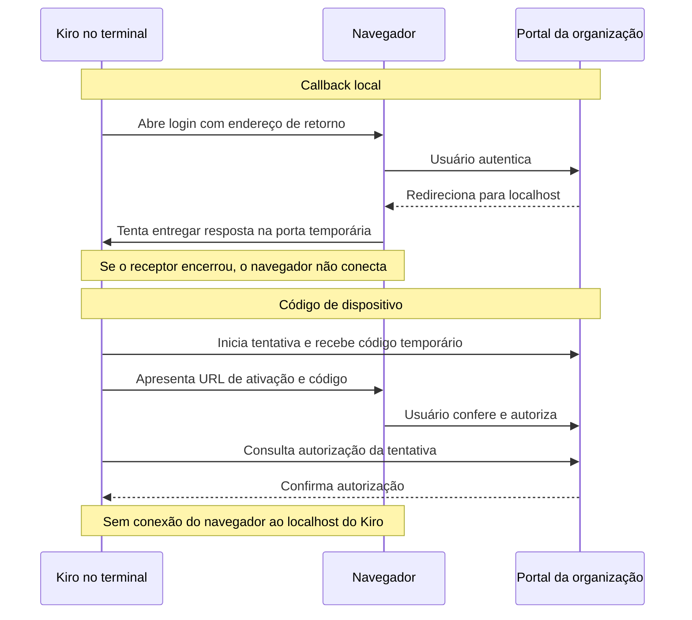

# Acesso ao Figma e recuperação de login do Kiro

Referência operacional da skill `figma-cota`, derivada da tarefa dori45 e da validação local em
22/10/2026. O objetivo é permitir que um agente receba o link de um frame e continue trabalhando
com o mínimo de intervenção e consumo de cota, sem confundir autenticações diferentes.

## O que foi comprovado nesta rodada

Ambiente: macOS, Kiro CLI 2.32.0, terminal persistente do tt.

- O Safari retornou a `http://127.0.0.1:<porta>/oauth/callback` e informou que não conseguia conectar.
- Ao diagnosticar, não havia listener naquela porta nem processo Kiro de login ativo.
- Uma nova execução de `kiro-cli login --use-device-flow`, em `tt --pty`, permitiu selecionar
  Organização e reaproveitar os dados que o próprio cliente apresentou.
- O portal da organização recebeu a aprovação do usuário; o terminal mostrou `Device authorized`
  e `Logged in successfully`.
- Depois disso, `kiro-cli mcp list` funcionou e listou `figma` no agente `kiro_default`.
- `kiro-cli mcp status --name figma` exibiu configuração habilitada. Esse comando não comprovou
  sessão OAuth do Figma, acesso a arquivo ou execução de ferramenta.
- Em uma sessão interativa `kiro-cli chat --legacy-ui`, o Kiro detectou o Figma sem OAuth e
  mostrou `figma requires OAuth authentication. Use /mcp to see the auth link`. O comando `/mcp`
  exibiu uma URL nativa `https://www.figma.com/oauth/mcp?...`. Nenhum Claude foi usado para gerar
  ou intermediar esse link. O retorno era para localhost, com listener ativo naquele momento.
- Os testes locais do script passaram sem token e sem chamadas ao Figma. O uso real do MCP do
  Figma continua sendo uma validação separada; não registrar como concluído por causa do login Kiro.

A causa imediata do erro do Safari foi a ausência de um receptor local. Não foi possível determinar
por que o processo anterior terminou: encerramento do terminal, timeout e execução em outra máquina
são hipóteses que devem ser verificadas em cada ocorrência, não conclusões desta rodada.

## Três autenticações diferentes

| Camada | Autoriza | Como verificar |
| --- | --- | --- |
| Login do Kiro | Usar o agente com a conta/organização | Terminal confirma login; comandos antes bloqueados por login funcionam |
| OAuth do MCP Figma | Ferramentas do Figma no cliente MCP | Fluxo OAuth concluído e consulta autorizada pelo servidor |
| Token pessoal REST | Script REST consultar arquivos permitidos | Requisição REST autorizada, contabilizada no livro |

O login do Kiro não substitui o OAuth do Figma. O token REST também não deve ser colado na
configuração OAuth. Ter a URL de um arquivo não concede acesso a ele.

## Por que o callback local pode falhar

No fluxo com callback, o CLI abre um pequeno servidor de retorno em uma porta temporária. O
navegador autentica no provedor e volta para esse servidor com dados da tentativa. O CLI precisa
continuar vivo e a porta precisa estar acessível na mesma máquina em que o navegador abre a URL.

Uma falha do Safari ao conectar em `127.0.0.1` é compatível com:

- processo encerrado ou prazo expirado enquanto o usuário autenticava;
- comando iniciado por uma ferramenta de execução curta, encerrada antes do callback;
- navegador no Mac e processo dentro de outra máquina, WSL, container ou sessão SSH;
- tentativa antiga reaproveitada depois de uma nova execução ter escolhido outra porta;
- falha de bind ou interferência local, a confirmar pelos logs/listener.

`127.0.0.1` sempre designa a máquina do navegador. Abrir um callback no Mac não o entrega a um
processo na máquina `empresa`. Se o servidor ainda estiver vivo na máquina correta, o fluxo local
pode funcionar normalmente; não há evidência de que o Safari seja incompatível com esse login.

Não é necessário liberar portas no roteador para corrigir uma tentativa local encerrada. Não
reconstrua uma resposta OAuth antiga nem inicie um servidor falso para receber seu código.

## Como o retorno muda entre os dois modos



## Diagnóstico sem expor credenciais

1. Identifique no terminal qual login está falhando: Kiro, MCP Figma ou outro cliente.
2. Leia a ajuda local: `kiro-cli --version` e `kiro-cli login --help`.
3. No Mac/Linux, confira o listener, substituindo PORTA pelo número visto no erro:

   ```bash
   lsof -nP -iTCP:PORTA -sTCP:LISTEN
   ```

   Sem `lsof`, use a ferramenta de sockets disponível no sistema. A ausência de listener explica
   a recusa naquele instante, mas não explica sozinha por que o processo encerrou.
4. Confira se o comando original ainda aguarda autorização e se navegador e CLI estão na mesma
   máquina. Se não estiver mais vivo, inicie uma tentativa nova pelo procedimento abaixo.
5. Não grave a URL completa de callback, parâmetros `code`/`state`, tokens nem capturas com esses
   dados no Git, descrição de tarefa ou relatório. Registre somente host, porta, etapa e erro.

## Procedimento validado: Organização por código de dispositivo

No CLI 2.32.0, a ajuda local oferece `--use-device-flow`. Esse modo mantém o CLI consultando a
aprovação no provedor; o navegador não precisa alcançar um servidor no localhost do CLI.

Use um terminal persistente. Para agentes sem tty:

```bash
tt --pty abrir figma-login "$HOME"
tt --pty enviar figma-login 'kiro-cli login --use-device-flow'
tt --pty ler figma-login 40
```

1. Selecione **Use with Your Organization**, navegando com `tt --pty tecla figma-login Down` e
   `Enter`. Leia o menu antes: ordem e opções podem mudar entre versões.
2. Confirme o Start URL e a região corretos da organização. Na validação do Hélio, o cliente
   apresentou `https://bluetrade.awsapps.com/start` e `sa-east-1`. Não aplique esses valores a
   outras organizações sem evidência.
3. O CLI apresenta uma URL de ativação e um código temporário. Abra a URL exatamente como
   apresentada no navegador do usuário. O usuário confere o código e aprova sua conta.
4. Mantenha o terminal aberto durante a autorização. Se aparecer senha ou MFA, o usuário realiza
   essa etapa; o agente não digita senha.
5. Leia novamente o terminal:

   ```bash
   tt --pty ler figma-login 40
   ```

6. Só considere o login concluído quando aparecer confirmação explícita. Nesta rodada foram
   `Device authorized` e `Logged in successfully`.
7. Verifique `kiro-cli mcp list`. Se falhar, registre a saída sem segredos; não repita autorizações
   indefinidamente. Se o código expirar, inicie nova tentativa e use somente o código novo.

Para o usuário acessar o terminal: `tt --pty entrar figma-login`. Ele volta com Ctrl-b d.
Uma espera que procura texto deve evitar uma expressão que já esteja no comando mostrado na tela:
procurar apenas `login` pode reconhecer o texto digitado e retornar antes de haver resultado.

### Alternativa ao dispositivo

Se a organização desabilitar device flow, ou se a versão do CLI/provedor não oferecer esse modo, mantenha o comando de login normal aberto em
um terminal persistente e conclua pelo navegador na mesma máquina. Confira a ajuda do cliente e o
fluxo do provedor antes de propor encaminhamento de porta. Não copie credenciais de outra conta.

## Conectar o MCP oficial do Figma

Endpoint remoto oficial: `https://mcp.figma.com/mcp`. Não foi necessário instalar proxy npm.

A ajuda do Kiro CLI 2.32.0 confirma:

```bash
kiro-cli mcp add --name figma --url https://mcp.figma.com/mcp --scope global
```

Alternativa: mesclar a entrada abaixo em `~/.kiro/settings/mcp.json`, preservando os demais
servidores, fazendo backup antes e sem substituir o arquivo por apenas esse exemplo:

```json
{
  "mcpServers": {
    "figma": {
      "url": "https://mcp.figma.com/mcp",
      "disabled": false
    }
  }
}
```

`mcp list` informa agentes e escopos. Uma entrada disponível para `kiro_default` não significa que
ela está disponível em todos os agentes personalizados: confira o agente usado na implementação.

### URL nativa de autenticação do MCP Figma: verificada

Na sessão interativa do Kiro CLI 2.32.0, o cliente detectou que o Figma exigia OAuth e instruiu:
`figma requires OAuth authentication. Use /mcp to see the auth link`.
Ao digitar `/mcp`, a seção `figma` exibiu:

```text
figma requires OAuth authentication. Follow this link to proceed:
https://www.figma.com/oauth/mcp?<parâmetros temporários omitidos>
```

Essa é uma URL produzida pelo próprio cliente MCP do Kiro. Não depende do Claude nem de
execução headless por outro agente. O usuário pode abrir o link mostrado na própria sessão.
Nesta validação, o link usava retorno HTTP para `127.0.0.1` com porta temporária, e havia um
listener ativo ao abrir o navegador. Mantenha a sessão Kiro aberta até concluir a autorização.

**O que isso comprova:** apresentação nativa da URL de autorização, adequada quando o navegador
não abre automaticamente. **O que ainda não comprova:** colar uma URL de callback de volta no
Kiro após falha do receptor, equivalência completa ao fluxo manual do Claude, OAuth Figma
concluído ou leitura real de um arquivo. Não confunda esses resultados.

`kiro-cli chat --legacy-ui` foi usado somente para inspecionar a interface sem migrar configurações
para V3. O cliente avisou que Classic seria descontinuado; não torne essa opção uma recomendação
permanente. Na interface atual do usuário, confira `/help` e a rota MCP equivalente.

`login --use-device-flow` documentado acima resolve o login do Kiro, não garante que o servidor
Figma ofereça device flow no seu OAuth.

O MCP desktop usa `http://127.0.0.1:3845/mcp` e depende de app/assento compatíveis. Seleção ao vivo
só é uma opção quando esse servidor está disponível no ambiente onde o cliente o acessa.

## Validação do acesso Figma sem desperdício

A configuração deve ser verificada em camadas:

1. **Login Kiro:** confirmado no terminal e por comando autenticado do cliente.
2. **Configuração MCP:** servidor habilitado e disponível no agente escolhido.
3. **OAuth Figma:** consentimento concluído com a conta que tem acesso ao arquivo.
4. **Leitura real:** uma consulta necessária a um frame conhecido, guardada por versão.

Antes da camada 4, rode `python3 scripts/figma_rest.py uso` da skill. Escolha uma consulta que
resolva uma necessidade real. Não faça buscas de páginas inteiras para testar conectividade.
Registre a chamada remota, inclusive tentativa rejeitada, e salve o resultado com chave/nó/versão.
Quem estiver validando precisa dizer quais camadas passaram e quais ainda dependem de autorização.

## Fallback por URL para Claude, Codex e Kiro

O usuário fornece o link do frame; o agente extrai chave e ID sem exigir que o usuário faça isso:

```bash
python3 scripts/figma_rest.py resolver 'https://www.figma.com/design/CHAVE/Tela?node-id=12-34'
python3 scripts/figma_rest.py ler 'https://www.figma.com/design/CHAVE/Tela?node-id=12-34'
```

`resolver` não acessa rede. `ler` consulta o JSON já baixado, também sem rede e sem token. O cache
padrão é por chave em `~/.cache/figma/CHAVE/`. Com `--cache DIR`, use uma pasta por arquivo.

Se não houver cache e o acesso REST estiver autorizado:

```bash
python3 scripts/figma_rest.py uso
python3 scripts/figma_rest.py baixar 'https://www.figma.com/design/CHAVE/Tela?node-id=12-34'
python3 scripts/figma_rest.py ler 'https://www.figma.com/design/CHAVE/Tela?node-id=12-34'
```

O download consome cota e não é executado automaticamente por `ler`. Sem token/permissão, o agente
informa a limitação e usa export/print fornecido pelo usuário. Esse fallback oferece estrutura,
textos e estilos que estejam no cache; não promete interpretação MCP, seleção ao vivo ou pixels
quando não há PNG. Links de instâncias com IDs compostos fora do formato numérico simples são
recusados pelo script; nesse caso, obtenha o link do frame correspondente, sem inventar IDs.

## Cuidados com cota e atualização

`versao` usa `GET /files/:key?depth=1`: resposta menor, mas mesma categoria Tier 1. Não trate como
uma sonda gratuita. Verifique uma vez por rodada quando for necessário e reutilize o resultado.
Uma mudança comunicada pelo designer é motivo para conferir; não faça polling contínuo.

HTTP 429 exige observar `Retry-After`; não prova por si só esgotamento mensal. O livro local
conta tentativas registradas, não informa o saldo oficial nem inclui outras máquinas. Consulte
as regras atuais do plano/assento e do arquivo, sem assumir que trocar o cliente renova o saldo.

Guarde a resposta MCP por chave, nó e versão. O script inclui `fileKey` em metadados novos e
recusa cache associado a outra chave. Cache legado sem origem requer confirmação da origem.

## Onde manter e como verificar

Fonte versionada no clone do tt: `skills/figma-cota/`, com `SKILL.md`, script, esta referência e
testes. Ela está versionada como recurso do repositório; esta entrega não altera o instalador do
tt nem instala a skill automaticamente em outras máquinas.

Instalação local já aplicada nesta rodada: `~/.agents/skills/figma-cota/`, com links nas pastas de
skills do Claude, Codex e Kiro. Atualizações devem copiar os arquivos mantidos da fonte versionada
para essa pasta, preservando recursos locais. Não substitua a pasta por um link para uma worktree
que poderá ser removida.

Verificação a partir da raiz do clone:

```bash
python3 -m unittest discover -s skills/figma-cota/tests -v
python3 skills/figma-cota/scripts/figma_rest.py resolver 'https://www.figma.com/design/ABC/Tela?node-id=12-34'
make test
```

Os testes de script usam cache sintético e respostas simuladas; não fazem login real nem gastam
cota. A recuperação do login Organização foi verificada com o usuário. A listagem MCP foi
verificada após esse login; a leitura real pelo MCP do Figma deve ser registrada separadamente.

## Fontes

- Ajuda local de `kiro-cli login`, `kiro-cli mcp add` e `kiro-cli mcp status`, CLI 2.32.0.
- [Kiro: autenticação](https://kiro.dev/docs/getting-started/authentication/)
- [Kiro: configuração MCP](https://kiro.dev/docs/mcp/configuration/)
- [Figma: endpoints de arquivos](https://developers.figma.com/docs/rest-api/file-endpoints/)
- [Figma: limites REST](https://developers.figma.com/docs/rest-api/rate-limits/)
- [Figma: limites MCP](https://developers.figma.com/docs/figma-mcp-server/rate-limits-access/)
